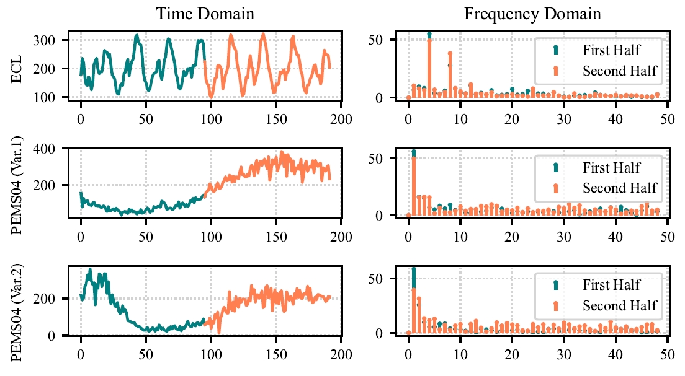
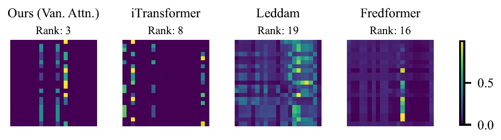
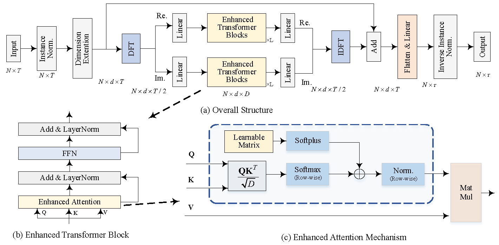
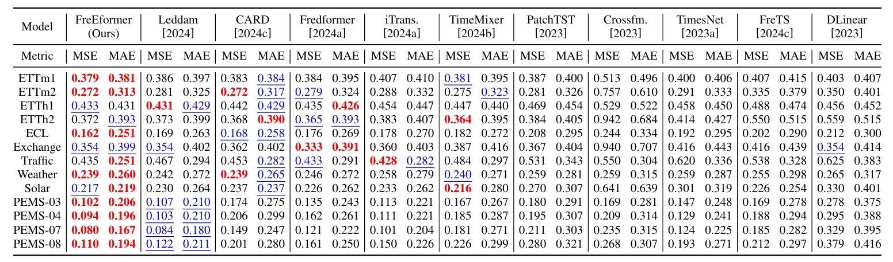
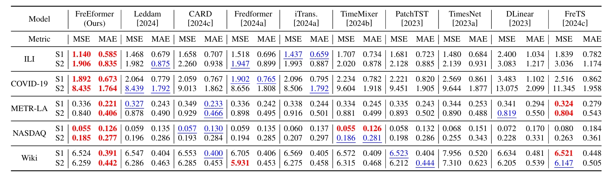
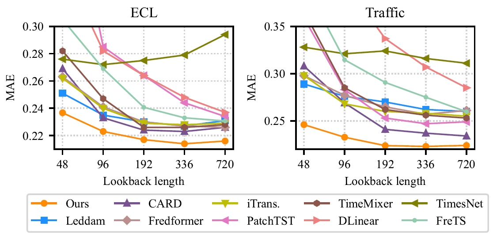
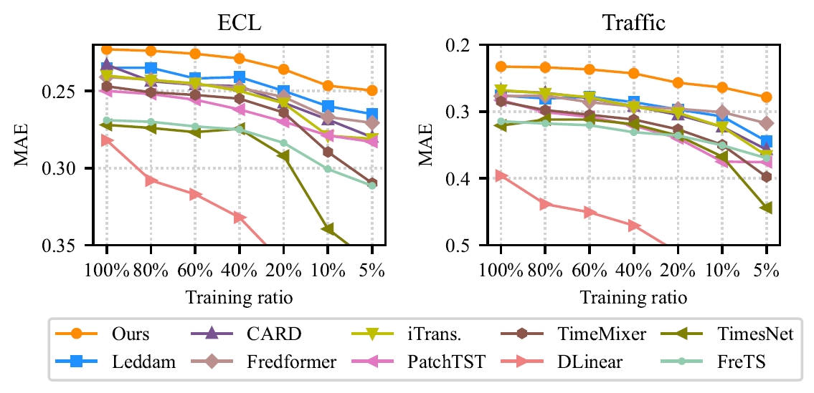
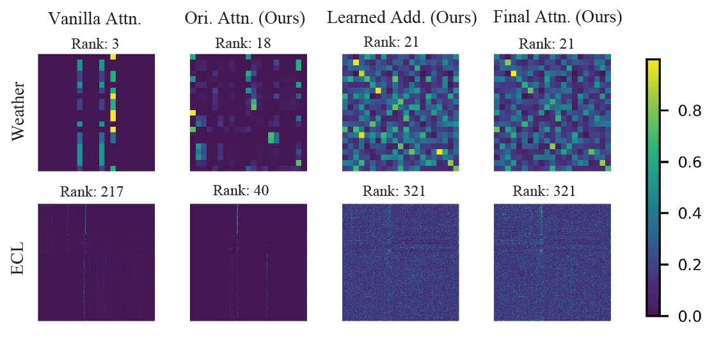
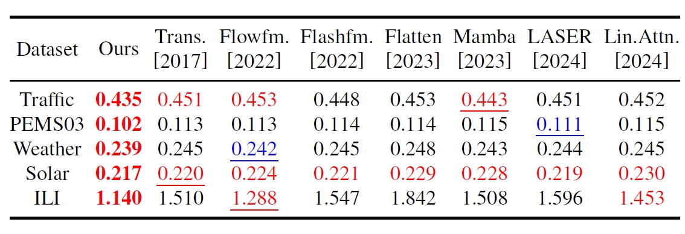
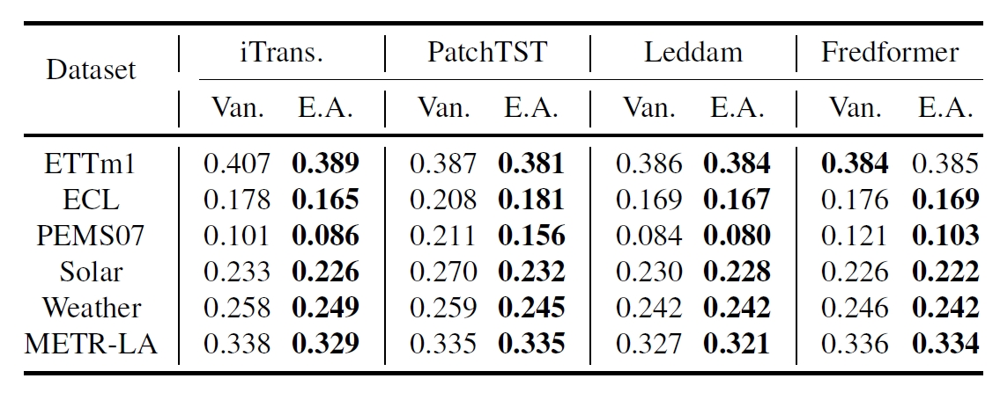

# FreEformer

The repo is the official implementation for the paper: FreEformer: Frequency Enhanced Transformer for Multivariate Time Series Forecasting. 


## Introduction

🌟  Frequency spectra generally exhibit strong consistency across different temporal spans of the same time series, providing a basis for frequency-based forecasting.

<p align="center">

</p>

🏆 FreEformer with the vanilla attention suffers from the low rank of attention matrix, which compromises the feature diversity. This could be explained by the inherent sparsity of the frequency spectrum and the nature of attention mechanism, 

<p align="center">

</p>

😊 Based on these two observations, we present FreEformer with the following architecture, featuring the frequency-domain multivariate representation learning and the enhanced attention mechanism. With minimal modifications to vanilla attention , the enhanced attention mechanism is proven effective both theoretically and empirically. 


<p align="center">

</p>


## Usage 

1. Install Pytorch and necessary dependencies.

```
pip install -r requirements.txt
```

1. Some datasets can be downloaded from [Google Drive](https://drive.google.com/file/d/1l51QsKvQPcqILT3DwfjCgx8Dsg2rpjot/view?usp=drive_link) or [Tsinghua Cloud](https://cloud.tsinghua.edu.cn/f/2ea5ca3d621e4e5ba36a/). The others can be obtained from the links in the supplementary material.

2. Train and evaluate the model. We provide the scripts under the folder ./scripts/. You can reproduce the results in the paper using these scripts.

```
# FreEformer
bash ./scripts/ECL_freformer_attn1.sh

# Vanilla attention and enhanced attention variants
bash ./scripts/enhanced_attn_variants/ECL_freformer_attn000.sh

# Architecture ablations
bash ./scripts/architecutre_ablation/ECL_freformer_linear_fre.sh

# Ablations: Real and imaginary parts sharing weights
bash ./scripts/real_imag_shared_concat/ECL_freformer_attn1_shared.sh

```

## Main Result of Multivariate Forecasting
We evaluate the FreEformer on extensive challenging multivariate forecasting benchmarks. **Comprehensive good performance** (MSE/MAE) is achieved by FreEformer. 

<p align="center">

</p>
<p align="center">

</p>

## Increasing Lookback Lengths

<p align="center">

</p>

## Less Training Data

<p align="center">

</p>


## Enhanced Attention

The enhanced attention can effectively improve the rank of the attention matrix.

<p align="center">

</p>

The enhanced Transformer outperforms the vanilla Transformer and state-of-the-art Transformer variants.

<p align="center">

</p>

It can also serve as a plug-in and consistently improve the performance of Transformer-based forecasters.

<p align="center">

</p>


## Acknowledgement

We appreciate the following GitHub repos a lot for their valuable code and efforts.
- iTransformer (https://github.com/thuml/iTransformer)
- Time-Series-Library (https://github.com/thuml/Time-Series-Library)
- Fredformer (https://github.com/chenzRG/Fredformer)
- Leddam (https://github.com/Levi-Ackman/Leddam)

